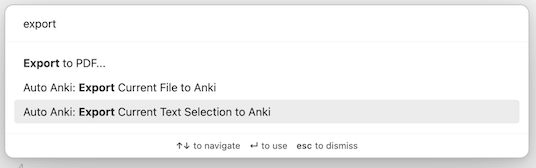
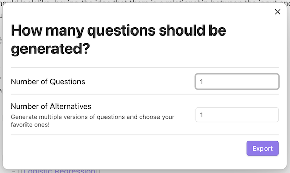
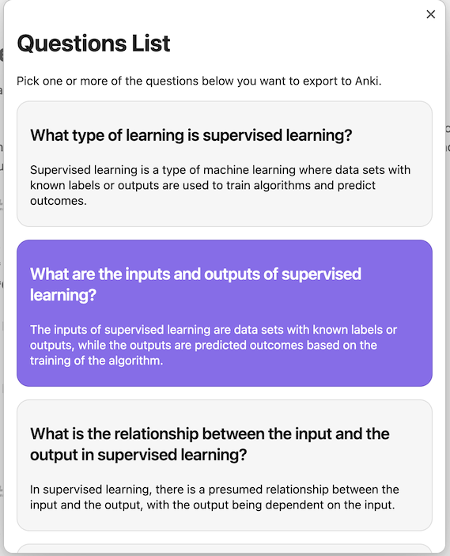

# Obsidian Auto Anki

Plugin for [Obsidian.md](https://obsidian.md/) that uses OpenAI's GPT LLM to automatically generate Flashcards for Anki.

> The plugin **only works for desktop**.

The plugin introduces two new "commands" into obsidian:
- _Export current file to Anki_
- _Export highlighted text to Anki_ (only available in an active `Editable` window open - i.e. you need to have a document open, and it needs to be in `edit` mode)

The command palette can be accessed on Obsidian through the following hotkey (default): `CMD` + `SHIFT` + `P`

.

If desired, you can set your own hotkeys for the new commands.

The two new commands look like the following:



## Plugin Requirements

The following are required for the Plugin to work:
- Obsidian 1.11.4 or newer, on desktop (older Obsidian versions get Auto Anki 0.2.2)
- An [OpenAI](https://openai.com/) Account and an [OpenAI API Key](https://platform.openai.com/account/api-keys)
- The [Anki](https://apps.ankiweb.net/) program, installed locally
- [Anki Connect](https://github.com/FooSoft/anki-connect), to expose an Anki API for Obsidian to make calls to

## Plugin Setup

1. Download and install the plugin (Options > Community Plugins)
2. Ensure that you have all the requirements in the [Plugin Requirements](#plugin-requirements)
3. Go to the Plugin Settings (Settings > Community Plugins > Auto Anki) and make sure to set the following fields appropriately:
    - Anki port (by default, this is `8765`)
    - OpenAI API key. It is saved in Obsidian's Keychain on this device (you'll see it under Settings > Keychain as `auto-anki-openai-api-key`), not in your vault. Obsidian encrypts Keychain secrets with your operating system's secret store when one is available (Settings > Keychain says if it isn't). The Keychain doesn't sync, so each device you use Auto Anki on needs the key entered once
    - OpenAI model (by default, `gpt-6-luna`). Any OpenAI chat model your API key can use works
4. Enjoy!

> **Upgrading from 0.2.1:** 0.2.1 always used `gpt-3.5-turbo-1106`, which OpenAI shut down on 28 September 2026, so it can no longer generate cards. From 0.2.2 the model is a setting; your other settings carry over unchanged.

> **Upgrading to 0.3.0:** earlier versions stored your OpenAI API key in plain text in the plugin's `data.json`, inside your vault, so anything that copies your vault (sync, backups, git) copied the key too. 0.3.0 moves it into Obsidian's Keychain automatically the first time it loads, removes it from `data.json`, and shows a notice when it has. Older copies of your vault may still contain the key, so consider replacing it at OpenAI. On any other device where you use the same vault, enter the key once in the Auto Anki settings. If one of those devices has an Obsidian older than 1.11.4, it stays on 0.2.2, which only reads the key from `data.json`: update Obsidian there too, or that device will keep asking for the key.

> **Also in 0.3.0:** the temperature, top-p, frequency penalty and presence penalty settings are gone. Current OpenAI models only accept their default values, so changing them made requests fail. **Reasoning effort** replaces them as the way to trade speed and cost against quality. **Maximum tokens per question** is replaced by **Maximum output tokens**, a single cap per request that includes the model's reasoning. 0.3.0 needs Obsidian 1.11.4 or newer.

## Feature Details

#### Exporting an Entire File to Anki (Command: _Export current file to Anki_)
This command allows you to use the contents of the currently-opened file to send to GPT and generate a list of questions and answers.



Alternatively, you can also specify the _number of alternatives_ to generate for each question. This allows you more variety in the "questions and answers" generated by GPT and it allows you to choose among a larger number of alternative "questions and answers". Choosing a number of alternatives work best with smaller notes.



From the generated list of "questions and answers", you have the option to pick and choose the ones you want.

After picking and choosing, your selected "questions and answers" automatically imports the chosen questions to Anki, based on the details in your Plugin settings.

> It may take a while if you are generating a large number of questions, or a large number of question alternatives.
An indicator will show whether `auto-anki` is currently generating your flash cards. This is shown in the status bar at the bottom of the screen, like below:


#### Exporting Highlighted Text to Anki (Command: _Export highlighted text to Anki_)
This command is similar to "Exporting an Entire File to Anki", but this allows you to use the currently-highlighted text (instead of the whole file) to send to GPT and generate a list of questions and questions. (Important Note: file needs to be in `edit` mode for the command to be available).

## Motivation

With the kajillion things I read and watch on a daily basis, I've recently found myself struggling to retain knowledge of the things I've consumed. Hence, I've found myself trying to find new ways to enhance my self-education. I came upon [Spaced Repetition](https://en.wikipedia.org/wiki/Spaced_repetition), and wanted to try to use [Anki](https://apps.ankiweb.net/) to supplement my daily learnings. Being a long-time user and lover of [Obsidian.md](https://obsidian.md/) as my PKM (Personal Knowledge Management), I wanted to see if there was a way to automate my learning using spaced repetition with my current Obsidian vaults.

I looked at other [similar plugins](https://github.com/Pseudonium/Obsidian_to_Anki) that attempt to connect Obsidian to Anki, but a lot of require you to change how you write your notes in Obsidian, or just don't seem automated enough. What this plugin does is automate the creation of ["flashcard-style" questions and answers](https://en.wikipedia.org/wiki/Leitner_system) but without needing to format your notes for this purpose.

I consider myself a complete beginner when it comes to Spaced Repetition, Anki, or the general world of learning techniques, so I am always very open to suggestions, discussions, or any comments about the topic!

## Issues, Discussion, etc

I keep track of all things related to this plugin mostly in [issues](https://github.com/cadrianxyz/obsidian-auto-anki/issues). Feel free to report bugs and/or requests there!

## Development

Requires Node.js 22 or later.

```bash
npm install
npm run dev     # rebuilds main.js on every change
npm run build   # type-checks, then makes a production build
npm run lint    # checks the code with ESLint, including Obsidian's own plugin-review rules
npm test        # runs the tests
```

The tests (in `test/`) load the plugin in Node against a stand-in for Obsidian, with a fake Keychain, a fake OpenAI and a fake AnkiConnect, so they need no vault, no API key and no Anki. They cover moving the API key out of `data.json` (including synced vaults and a Keychain that fails), reading settings saved by every earlier version, and the export flow with its error messages. They also check that notes are never changed and that Anki is only ever asked to add cards. The release workflow runs them before building.

To test in a vault, point `OBSIDIAN_PLUGIN_DIR` at the plugin's folder inside that vault. Every build is then copied there (`main.js`, `manifest.json`, `styles.css`):

```bash
OBSIDIAN_PLUGIN_DIR=~/path/to/vault/.obsidian/plugins/auto-anki npm run dev
```

Then reload the plugin in Obsidian (Settings > Community Plugins), or install the [Hot Reload](https://github.com/pjeby/hot-reload) plugin to have it reloaded after every build.

### Releasing

`npm version <new-version>` updates `manifest.json` and `versions.json`. Push the tag (`git push origin <new-version>`): the release workflow builds the plugin and attaches `main.js`, `manifest.json` and `styles.css` to a GitHub release with that tag. Push the branch afterwards, since Obsidian reads `manifest.json` from the default branch to decide which release to install.
