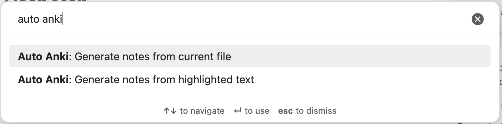

# Obsidian Auto Anki

Turn your [Obsidian](https://obsidian.md/) notes into [Anki](https://apps.ankiweb.net/) flashcards with AI (OpenAI or Claude).

Open a note (or highlight part of it) and run a command. The AI writes Anki notes, you pick the ones you like, and they go straight into Anki. You don't need to change how you write your notes.

> Auto Anki **only works on desktop**.

## What you need

- **Obsidian 1.13.1 or newer**, on desktop.
- **Anki**, installed on your computer and open while you use the plugin.
- **[AnkiConnect](https://ankiweb.net/shared/info/2055492159)**, an Anki add-on that lets Obsidian talk to Anki.
- **An API key from [OpenAI](https://platform.openai.com/api-keys) or [Claude](https://platform.claude.com/).** An API key is like a password that lets the plugin use your AI account. Usage is billed by the provider, separately from a ChatGPT or Claude chat subscription, which doesn't include it.

## Quick start

1. In Obsidian, install **Auto Anki** from **Settings → Community plugins** and turn it on.
2. In Anki, install AnkiConnect (**Tools → Add-ons → Get Add-ons**, code `2055492159`), then restart Anki.
3. In Obsidian, open **Settings → Auto Anki**. Under **AI providers**, choose **OpenAI** or **Claude**, paste your API key and click **Save key**.
4. On that same page, click **Manage models** (the gear icon beside **Your models**). Turn on at least one model and click **Save changes**.
5. Open **Settings → Auto Anki → Anki**. Under **Note types**, choose which of your Anki note types the AI may use. **Basic** and **Cloze** are on to start.
6. Open a note, press **Ctrl/Cmd + P**, and run **Auto Anki: Generate notes from current file**.

## How it works

The plugin adds two commands:

- **Generate notes from current file**: uses the whole open note.
- **Generate notes from highlighted text**: uses only the text you've selected, in editing view.

Each run has three steps:

1. **Generate:** check the options and click **Generate Anki notes**.
2. **Review:** tick the notes you want to keep.
3. **Export:** choose a deck and click **Confirm and export**.

## Guides

- [Providers and models](docs/providers-and-models.md): add API keys, choose models, adjust model settings.
- [Generating notes](docs/generating-notes.md): the generate, review and export steps, writing preferences, and images.
- [Note types](docs/note-types.md): choose which kinds of Anki notes the AI writes.
- [Deck selection](docs/deck-selection.md): choose a default deck, or suggest one from each note's folder.
- [Tags](docs/tags.md): tag new Anki notes so you can find them later.

## Privacy and safety

- Nothing is sent anywhere until you click **Generate Anki notes**. Then your note's text (or the selected text) and its images go to the provider you chose.
- API keys are kept in Obsidian's Keychain on this computer, not in your vault. They don't sync, so add your key again on each computer.
- Auto Anki only **adds** notes to Anki. It never edits or deletes notes already there, and it never changes your Obsidian notes.

## Upgrading

The [changelog](CHANGELOG.md) lists what changed in each version and anything you need to check after upgrading.

## Motivation

With the kajillion things I read and watch on a daily basis, I've recently found myself struggling to retain knowledge of the things I've consumed. Hence, I've found myself trying to find new ways to enhance my self-education. I came upon [Spaced Repetition](https://en.wikipedia.org/wiki/Spaced_repetition), and wanted to try to use [Anki](https://apps.ankiweb.net/) to supplement my daily learnings. Being a long-time user and lover of [Obsidian.md](https://obsidian.md/) as my PKM (Personal Knowledge Management), I wanted to see if there was a way to automate my learning using spaced repetition with my current Obsidian vaults.

I looked at other [similar plugins](https://github.com/Pseudonium/Obsidian_to_Anki) that attempt to connect Obsidian to Anki, but a lot of require you to change how you write your notes in Obsidian, or just don't seem automated enough. What this plugin does is automate the creation of ["flashcard-style" questions and answers](https://en.wikipedia.org/wiki/Leitner_system) but without needing to format your notes for this purpose.

I consider myself a complete beginner when it comes to Spaced Repetition, Anki, or the general world of learning techniques, so I am always very open to suggestions, discussions, or any comments about the topic!

## Issues and ideas

Report bugs and request features in [GitHub issues](https://github.com/cadrianxyz/obsidian-auto-anki/issues).

Want to work on the plugin itself? See [CONTRIBUTING.md](CONTRIBUTING.md).
