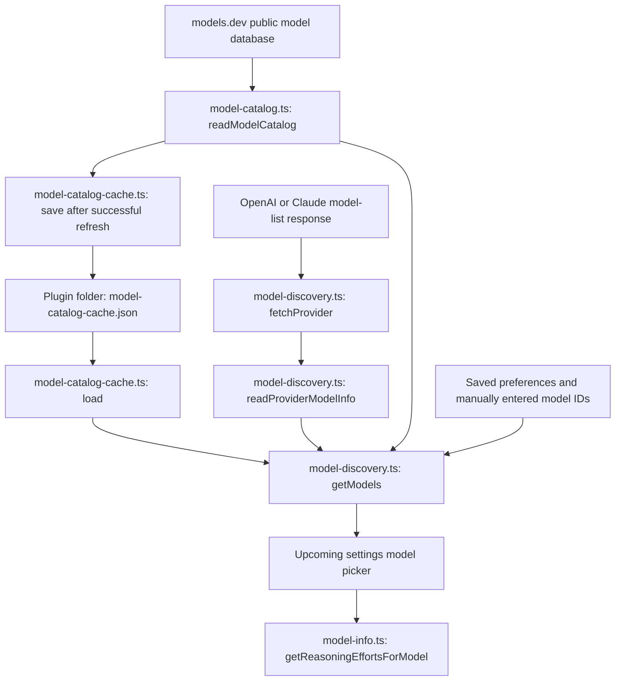

# Model discovery: data flow and integration status

The new discovery service currently runs in tests. The existing `src/main.ts`
still uses the 0.3 settings screen and export commands. The next development
milestone connects this service to the 1.0 settings screen and settings loader.
The separate cache-file implementation and discovery's automatic restore/save
calls are implemented and tested; the running plugin does not instantiate them yet.

## Where each function belongs

`readProviderModelInfo` is required at the network boundary: it checks the raw
provider response and translates provider-specific names into our common model
information. It lives beside the fetch that consumes that response.

`model-info.ts` defines that common information, the `OutputMode` enum, cached
capability validation and offline reasoning-option selection. Those are shared
between discovery and saved-settings validation, so they do not depend on a fetch.

`utils/data.ts` holds generic checks for objects, strings, booleans, options and
positive whole numbers. AnkiConnect URL rules and Anki field mappings remain in
settings because they describe that setting's meaning, not a generic data type.

`model-catalog-cache.ts` handles reading and writing the separate cache file through
Obsidian's vault adapter. `model-catalog.ts` validates the public data stored there.
Neither uses the settings loader or `data.json` for catalogue storage.

## Planned runtime calls

| User action or event | Code to run when the settings interface is integrated |
|---|---|
| Plugin starts | `prepareSettings()` validates/upgrades data.json. Create `ModelCatalogCacheFile` with `app.vault.adapter` and `plugin.manifest.dir`, pass it to `ModelDiscovery`, and await `restoreCatalog()` to restore public metadata without a network request. If the installed plugin directory is unavailable, omit file caching. |
| A configured provider's settings page opens | Read its key from the Keychain and call `refreshProvider()`. Request optional public metadata through `refreshCatalog()`, which reuses a successful catalogue download for 24 hours. |
| User explicitly refreshes models | Call `refreshProvider()` and `refreshCatalog(true)`. |
| User enters a model ID or the live list changes | Call `getModels()` with saved and manual IDs to rebuild the choices. |
| A model's reasoning dropdown is rendered | Call `getReasoningEffortsForModel()` with its known capabilities. This makes no network request. |
| A public catalogue refresh succeeds | `refreshCatalog()` automatically saves the public snapshot to `model-catalog-cache.json`. It does not trigger a settings save. |
| Cards are generated | Use the selected model and its settings. Model-list discovery is not a separate test before each generation. |

The service does not schedule a daily background job. The 24-hour age is checked
when `refreshCatalog()` is called. Paid capability testing through the model's
Test button is a separate feature in the AI-adapter milestone.
`refreshCatalog()` also awaits the one-time disk restore itself, so the freshness
check remains correct even if the caller has not restored the cache at startup.

## Why the public catalogue does not configure connections

models.dev (https://models.dev) is an independently maintained public database of
model names, supported input formats and token limits. It can supply information
that a provider's own model-list response omits. It does not establish which
models an account can use, and an absent entry must not prevent a new model ID
from being selected.

For 1.0, connection addresses and authentication headers stay in the two provider
presets, checked against provider documentation. This keeps credential routing
stable when descriptive metadata updates and lets provider discovery work even
when the public catalogue is unavailable. The tradeoff is that an official API
address change requires a preset update. User-specified custom addresses belong
to the planned custom-provider release.

The catalogue's SDK-package fields describe how other software can instantiate
SDKs. Auto Anki has its own two protocol adapters and uses Obsidian's `requestUrl`,
so those package names do not configure anything in this implementation.

## What is saved, and why

| Data | Lifetime | Reason |
|---|---|---|
| Public catalogue names and capability hints | Normalised snapshot in `model-catalog-cache.json` inside the installed plugin folder | Reuse across restarts, display saved models offline, and avoid downloading again on every launch. This replaceable data stays separate from user settings. |
| Provider's current account-specific model list | Memory | Keys and account access can differ between devices sharing data.json; a synced list must not be treated as access granted on another device. Saved/manual model IDs remain selectable. |
| User's selected model and per-model preferences | Existing settings in `data.json` | Discovery must not replace explicit choices. |
| Active requests, cancellation callbacks and request credentials | Memory while requests are active | They cannot be restored meaningfully after restarting and must not enter the saved cache. |

Only the supported providers' normalised model information is saved, not the full
public response. Addresses, SDK fields, keys and account availability are excluded.
The path comes from `plugin.manifest.dir`, so custom Obsidian config directories
work without hardcoding `.obsidian`. No additional vault folder is created, and
no cache metadata is written to `data.json`. This separate cache file follows the
review decision to keep downloaded metadata out of the settings file.

A missing, unreadable or malformed file is treated as an empty cache. The next
successful download recreates it. A failed file write does not prevent the fresh
metadata from being used in memory. Deleting the cache file does not remove user
preferences; it only causes metadata to be downloaded again on a later launch.

A stale snapshot remains useful when refresh fails. It supplies labels and hints,
not proof of current availability or a reason to change a selected model. A
provider response takes precedence over saved capability results and catalogue
hints; explicit user overrides are held separately.
