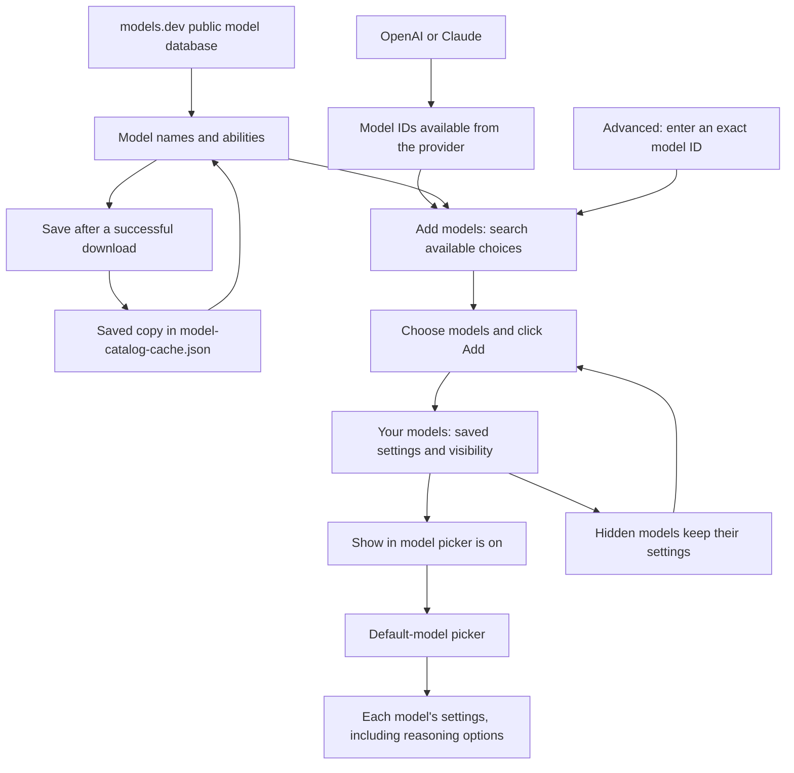

# Setting up card generation

Auto Anki uses an AI service to turn your notes into flashcards. The service,
such as OpenAI or Claude, is the **provider**. The **model** is the particular AI
you choose from that provider. Each model can keep its own settings.

This guide describes the settings in the 1.0 development build. You can configure
OpenAI and Claude, but card generation currently works through OpenAI. Claude
generation and the broader Anki note-type workflow are still being implemented.
The current export flow makes text question/answer cards. Diagrams can inform
those cards; displaying images on cards and generating cloze cards come later.

## Set up a provider

An **API key** is a credential from the provider that lets Auto Anki use your AI
account. Enter the key for the provider you chose.

1. Open **Settings → Auto Anki** and choose **OpenAI** or **Claude**.
2. Enter your provider's API key and click **Save key**. Saving checks that the
   Keychain kept the key; fetching the model list then checks the provider connection.
3. **Your models** contains models you have added. **Add models** (the plus
   button beside search) opens the full provider list. Select the models you
   want and click **Add** to put them in your normal picker.
4. Choose **Use as default model**, or choose the model from **Default model**
   on the main Auto Anki settings page.

The first time you connect a provider, Auto Anki adds one suggested model to get
you started. It becomes your default if none is selected. Connecting another
provider keeps your existing default. Replacing a key keeps your model choices.

**Refresh models** sits beside search inside **Add models**. It updates the
available choices without enabling them or changing your default.

Adding a model means enabling an existing provider model in your picker. It does
not create or train an AI. If a new model or exact version is missing from the
list, open **Advanced: enter a model ID** in Add models and enter the provider's
exact ID. Your account still needs access to that model.

To hide a model, open it under **Your models** and turn off **Show in model
picker**. Its settings are kept, and you can turn it on again later. Hiding your
default clears the default selection; choose another before generating cards.
Adding a hidden model again also enables it with its saved settings.

Keys are kept in Obsidian's Keychain on this computer. If you sync the vault to
another computer, add the key there too. A model saved on another computer can
still be edited under **Your models**. Until its provider has a key on this
device, **Add models**, discovery controls and **Use as default model** are
hidden. The default-model picker offers enabled models from providers with a
saved key, and stays hidden when there are no choices. A saved default that
needs a key is kept, with a reminder to add that provider's key.
An empty key box does not delete a saved key. Remove keys through Obsidian's
Keychain settings when needed.

## Understand a model's settings

| Setting | What it means |
|---|---|
| Reasoning effort | How much the model thinks before answering. **Model default** lets the provider choose. Other available levels vary by model. |
| Maximum output tokens | A ceiling on the response length, including reasoning where the provider counts it. Tokens are the units the provider uses to measure text. The default is 25,000; you pay for what is used. |
| Output mode | How Auto Anki asks the model to return card data in a form the plugin can read. Leave **Auto** selected unless troubleshooting. |
| Accepts images | Whether the model can read diagrams sent with a note. **Auto** uses the available model information; **Yes** and **No** let you override it. |

Changing one model's settings leaves your other models' settings as they were.
Saving a setting does not generate cards.
**Output mode** and **Accepts images** are under the model's **Advanced** page;
ordinary use can leave both at Auto.

## Choose how your cards are written

Open **Settings → Auto Anki → Cards**. These preferences are shared by your
models and used by the export commands. Set them once, then generate cards
from a note or a selection.

- **Send diagrams** includes supported images embedded in the note when the
  selected model accepts images. It starts on. Only vault attachments are sent;
  web images are skipped. Images are resized locally before sending. GIFs are
  analysed using their first frame, and the original file is left unchanged.
- **Coverage** controls how much detail to turn into cards. Choose **Key ideas
  only**, **Main ideas and important details** (the default), or **Everything
  worth remembering**. More detail usually means more cards.
- **Extra instructions** adds standing preferences such as “Use British
  spelling.” Use headings, lists and multiple lines of Markdown. Your text is
  saved exactly as typed, including spaces and blank lines.

Under **Cards → Advanced**, **Card-writing instructions** shows the built-in
guidance for writing focused, accurate cards. Editing it replaces that guidance;
the response-format rules needed by Auto Anki are separate and cannot be edited
here. For small preferences, use Extra instructions to keep receiving updates
to the built-in guidance.

Your edited guidance is kept through plugin updates. **Reset to default**
discards that edit and returns to the current built-in guidance, including future
improvements. Reset leaves your extra instructions, coverage and diagram
preference unchanged. You can edit these preferences before adding an API key;
opening the page or saving an edit makes no AI request.

## Generate and review cards

Open a note and run **Auto Anki: Export current file to Anki** from Obsidian's
command palette. To use only part of the note, select it and run **Auto Anki:
Export highlighted text to Anki**. Anki and AnkiConnect must be running.

The dialog shows your selected model, which material will be sent, and any
diagrams that must be skipped. Frontmatter and Obsidian comments are excluded.
For a selection, only images embedded in that selection are included.

**Coverage** starts with your saved choice. Changing it here affects this run
only. Under **Advanced**, **Maximum cards** is an optional ceiling, not a target.
It starts empty for a whole note and at three for a selection. **Instructions
for this run** adds one-off guidance after your saved extra instructions; it is
not saved. Both instruction editors preserve multiline Markdown.

Click **Generate cards** to send the request. Review the resulting text cards,
select the ones to keep, then choose an existing Anki deck and export. Suspected
mistakes in the source and skipped content are shown alongside the cards, even
when no cards can be generated. The plugin does not change your source note.

Auto Anki asks for structured card data. In **Auto** output mode, an explicit
unsupported-format error allows it to try a compatible format and remember the
one that worked. Ordinary generation does not run a separate capability test.
Authentication errors, rate limits, refusals and malformed replies do not trigger
another generation request automatically.

## Where the model choices come from

Auto Anki asks connected providers for their model lists when you open settings.
**Refresh models** fetches the list again whenever you need it. New IDs become
available in **Add models** without a plugin update. Refreshing never puts them
in the normal picker automatically: you choose which ones to enable. Saved or
manually entered IDs stay available even when a refresh fails.

In either provider's **Add models** screen, you can browse the full discovered list. Models reported
as unable to generate text are labelled and cannot be selected for flashcards;
unknown capabilities remain selectable. Being listed does not guarantee that a
model supports Auto Anki's generation request format.

The normal picker contains only enabled models. Your current default appears
first, then models with known release dates from newest to oldest, then names
and IDs. **Add models** puts your saved models first, followed by the same date
and name ordering. This is a browsing order, not a ranking of flashcard quality.

If discovery fails, your saved choices remain usable. A saved model stays
enabled until you hide it, even if a later provider list omits its ID. You may
need to check with the provider if that model no longer works for your account.

[models.dev](https://models.dev/) is a public database that adds readable model
names and information such as image support and token limits. It supplements the
provider's list. It does not decide which models your account can access.

Your API key goes to the selected provider. Requests to models.dev contain no
API key or note content. Downloaded model information
cannot change the provider address used for your connection.

## What is saved

| Information | Where it is kept |
|---|---|
| API keys | Obsidian's Keychain on this computer. |
| Your added models, their settings and whether they are enabled | The plugin's `data.json` settings file. |
| Public model names and abilities | A separate `model-catalog-cache.json` file in the installed plugin folder. |
| The provider's current model list | Memory while the plugin is running; it is fetched again on a later settings visit. |

A **cache** is a saved copy of downloaded information. Auto Anki restores the
public model information when the plugin starts. When model information is next
requested, it normally reuses this copy for up to 24 hours. **Refresh models**
requests a fresh copy immediately.

If a download fails, the previous copy can still provide model names and details.
If the cache file is missing or unreadable, Auto Anki can download it again. You
can delete that file without losing your settings or keys; a failed cache save
also leaves newly downloaded information usable while the plugin is running.

Settings from an older Auto Anki version are upgraded when loaded. Changes synced
from another computer are also checked before use. If the settings file cannot
be read or needs a newer plugin version, Auto Anki keeps the previous choices
and disables editing until a successful reload, so edits cannot overwrite that
file with the wrong settings.
