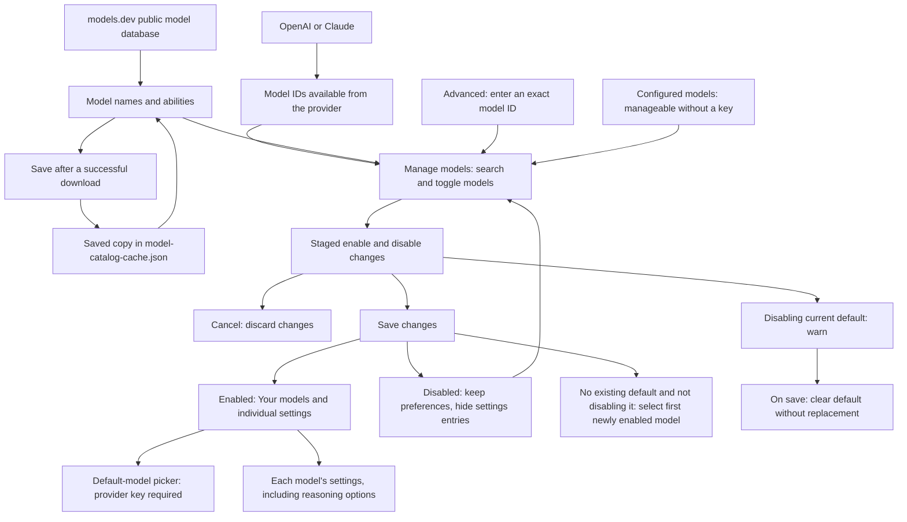

# Setting up Anki note generation

Auto Anki uses an AI service to turn your Obsidian source material into Anki notes.
An Anki note stores fields such as a question and answer. Its note type’s
templates create the flashcards you study: one note can create several cards.

The AI service, such as OpenAI or Claude, is the **provider**. The **model** is the particular AI
you choose from that provider. Each model can keep its own settings.

OpenAI and Claude both generate Anki notes through the same dialog and use your
saved preferences. Text goes directly into the fields of your enabled Anki note
types, including custom types with more than two fields. Diagrams can inform those
notes, and can be shown on the cards.

## Set up a provider

An **API key** is a credential from the provider that lets Auto Anki use your AI
account. Enter the key for the provider you chose.

1. Open **Settings → Auto Anki** and, under **AI providers**, choose **OpenAI** or **Claude**.
2. Enter your provider's API key and click **Save key**. Saving checks that the
   Keychain kept the key; fetching the model list then checks the provider connection.
3. **Your models**, on the provider's page, contains your enabled models. **Manage models**
   (the `settings-2` button beside **Your models**) opens a modal with your configured
   models and the available provider list. Toggle models on or off, then click
   **Save changes** to apply them. Toggles are staged until you save; **Cancel**
   discards the staged changes.
4. Choose **Use as default model**, or choose the model from **Default model**
   under **AI providers** on the main Auto Anki settings page. Showing that
   picker refreshes model information for providers with a saved key; a provider
   whose model information could not be refreshed shows a warning on its row.

Connecting a provider enables no models; choose them under **Manage models**. If no
existing default is selected, the first model you enable becomes it when you save.
Replacing a key keeps your model choices.

**Refresh models** sits beside search inside **Manage models**. It updates the
available choices without enabling them or changing your default.

Enabling a model makes an existing provider model available in your picker. It does
not create or train an AI. If a new model or exact version is missing from the
list, open **Advanced: enter a model ID** in **Manage models** and enter the provider's
exact ID. Your account still needs access to that model.

To disable a model, turn it off in **Manage models** and click **Save changes**.
Its preferences are kept, but it disappears from **Your models**, the provider's
individual-settings entries and the normal picker. Re-enable it through the same
modal to use its saved preferences again.

Disabling the current default shows a warning. Saving clears the default without
choosing a replacement, even if you enable other models in the same save. Choose
another default before generating Anki notes.

Keys are kept in Obsidian's Keychain on this computer. If you sync the vault to
another computer, add the key there too. A model saved on another computer can
still be edited under **Your models** while enabled. **Manage models** remains
available without a key when configured models exist, so you can enable or disable
those models. Provider discovery controls and **Use as default model** still
require a saved provider key on this device. The default-model picker offers enabled models from providers with a
saved key, and stays hidden when there are no choices. A saved default that
needs a key is kept, with a reminder to add that provider's key.
An empty key box does not delete a saved key. Remove keys through Obsidian's
Keychain settings when needed.

## Understand a model's settings

| Setting | What it means |
|---|---|
| Reasoning effort | How much the model thinks before answering. **Model default** lets the provider choose. Other levels are the ones reported for that model; the setting appears once they are known. A level you chose is kept, and marked if the model no longer reports it. |
| Maximum output tokens | A ceiling on the response length, including reasoning where the provider counts it. Tokens are the units the provider uses to measure text. The default is 25,000; you pay for what is used. |
| Output mode | How Auto Anki asks the model to return Anki note data in a form the plugin can read. Leave **Auto** selected unless troubleshooting. |
| Accepts images | Whether the model can read diagrams sent with a note. **Auto** uses the available model information; **Yes** and **No** let you override it. |

Changing one model's settings leaves your other models' settings as they were.
Saving a setting does not generate Anki notes.
**Output mode** and **Accepts images** are under the model's **Advanced** page;
ordinary use can leave both at Auto.

## Choose how your Anki notes are written

Open **Settings → Auto Anki → Generation**. These preferences are shared by your
models and used by the export commands. Set them once, then generate Anki notes
from a note or a selection.

- **Send diagrams** includes supported images embedded in the note when the
  selected model accepts images. It starts on. Only vault attachments are sent;
  web images are skipped. Images are resized locally before sending. GIFs are
  analysed using their first frame, and the original file is left unchanged.
- **Coverage** controls how much detail to turn into Anki notes. Choose **Key ideas
  only**, **Main ideas and important details** (the default), or **Everything
  worth remembering**. More detail usually means more Anki notes.
- **Extra instructions** adds standing preferences such as “Use British
  spelling.” Use headings, lists and multiple lines of Markdown. Your text is
  saved exactly as typed, including spaces and blank lines.

Under **Generation → Advanced**, **Note-writing instructions** shows the built-in
guidance for writing focused, accurate Anki notes. Editing it replaces that guidance;
the response-format rules needed by Auto Anki are separate and cannot be edited
here. For small preferences, use Extra instructions to keep receiving updates
to the built-in guidance.

Your edited guidance is kept through plugin updates. **Reset to default**
discards that edit and returns to the current built-in guidance, including future
improvements. Reset leaves your extra instructions, coverage and diagram
preference unchanged. You can edit these preferences before adding an API key;
opening the page or saving an edit makes no AI request.

## Choose where content goes in Anki

Open Anki with AnkiConnect enabled, then open **Settings → Auto Anki → Anki**.
Auto Anki lists the note types already in your collection. Enable each type you
want the AI to use. Basic and Cloze are selected initially; you can turn them off
and select custom types instead. Refreshing the list never enables new types for you.

The AI receives each enabled type's exact fields, available field descriptions
and card templates. It chooses appropriate types for the source material and fills
those fields directly. It does not need to use every enabled type in every run.
There are no question/answer field-mapping controls. Maintain field descriptions
in Anki when you want to clarify their meaning, and check the generated text during review.

Optional fields may be empty. The first field must contain text, and cloze notes
must contain valid deletions in the fields their templates use for cloze. Types
requiring generated media or image-occlusion masks are unavailable in this text
workflow, with an explanation beside the type. Additional text fields are supported.
The plugin never creates or changes your note types, fields or card templates.

Use **Refresh note types** after importing or changing a type in Anki. Missing or
unverified types retain their selections but are excluded from generation until
they are available again. You can turn off a missing selection even while Anki
is disconnected. New selections must refer to a type currently verified in Anki.

Auto Anki reads the selected definitions before generation and checks them again
before export. If their fields, descriptions, templates or identity change during
review, export stops and keeps your generated notes. Restore the original type to
retry, or generate again using its updated definition. Settings changes during
review do not redirect notes already generated.

## Generate and review Anki notes

Open a note and run **Auto Anki: Generate notes from current file** from Obsidian's
command palette. To use only part of the note, select it and run **Auto Anki:
Generate notes from highlighted text**. Anki and AnkiConnect must be running.

The dialog shows your selected model, which material will be sent, and any
diagrams that must be skipped. Frontmatter and Obsidian comments are excluded.
For a selection, only images embedded in that selection are included.

**Coverage** starts with your saved choice and is shown outside **Advanced**.
Changing it here affects this run only. Expand **Note types** to adjust the enabled
types; its summary lists the types selected for this run.

Under **Advanced**, **Model** chooses the model for this run, and **Reasoning effort**
starts with that model's saved value. The effort choices update when you switch
models. These changes do not alter your saved defaults. **Maximum notes** limits
Anki notes, not flashcards. It is an optional ceiling, not a target, and starts
empty for both whole notes and selections.
**Extra instructions** starts with your saved text. Edit or clear it to replace
that guidance for this run only, without changing your saved settings. Markdown,
spacing and line breaks are preserved.

Click **Generate Anki notes** to send the request. Review the resulting Anki notes,
select the ones to keep, then choose an existing Anki deck and export. With tagging
on, the deck step also lets you change this export's extra tags (see
[Tags](../README.md#tags)). Each entry shows its note type and all its field values
as text, including cloze markup and intentionally empty fields. Suspected mistakes
in the source and skipped content are shown alongside the generated notes, even
when no Anki notes can be generated. If Anki disconnects or refuses an entry, the
export dialog stays open for retry; entries already confirmed as added are left
out of that retry. **Back to selection** returns to the remaining entries. The plugin
does not change your source note. Before adding notes, it asks Anki whether each
can be added (`canAddNotes`). Rejected notes stay in review; eligible notes are
added and their individual results are checked.

Auto Anki asks for structured Anki note data. In **Auto** output mode, an explicit
unsupported-format error allows it to try a compatible format and remember the
one that worked. Ordinary generation does not run a separate capability test.
Authentication errors, rate limits, refusals and malformed replies do not trigger
another generation request automatically.

Both providers are called through their official SDKs: OpenAI's Responses API
(with response storage turned off) and Claude's Messages API. Each uses native
structured output when available. The fallback formats are a named function
response, then a JSON instruction; no function is executed. Reasoning effort uses
the model's own default unless you choose a level. A failed connection is reported
rather than retried, so one click never sends the same paid request twice.

Closing a generation dialog cancels the request in progress, and a late reply
cannot open the review screen. A request the provider has already started may
still finish and be billed. A generation that takes longer than ten minutes stops
with a timeout message; try a smaller selection or a lower reasoning effort.

## Where the model choices come from

Auto Anki asks connected providers for their model lists through their official
SDKs when you open settings. A refresh has a ten-second deadline across all pages;
changing a key cancels the previous account's pending refresh. **Refresh models**
fetches the list again whenever you need it. New IDs become
available in **Manage models** without a plugin update. Refreshing never puts them
in the normal picker automatically: you choose which ones to enable. Saved or
manually entered IDs stay available even when a refresh fails.

In either provider's **Manage models** modal, you can browse the full discovered list.
Models reported as unable to generate text are labelled and cannot be enabled;
existing enabled non-text models can still be disabled. Models with unknown
capabilities can be enabled. Being listed does not guarantee that a model supports
Auto Anki's generation request format.

The normal picker contains only enabled models. Your current default appears
first, then models with known release dates from newest to oldest, then names
and IDs. **Manage models** puts your saved models first, followed by the same date
and name ordering. This is a browsing order, not a ranking of flashcard quality.

If discovery fails, your saved choices remain usable. A saved model stays
enabled until you disable it, even if a later provider list omits its ID. You may
need to check with the provider if that model no longer works for your account.

[models.dev](https://models.dev/) is a public database that adds readable model
names and information such as image support, token limits and, for OpenAI models,
the reasoning effort levels each accepts. Claude reports its levels itself. It supplements the
provider's list. It does not decide which models your account can access.

Your API key goes to the selected provider using the SDK's Bearer authentication.
Requests to models.dev contain no API key or note content. Downloaded model
information cannot change the provider address used for your connection.

Auto Anki uses the keys saved in its settings, not SDK custom-header configuration
from your desktop environment. If `OPENAI_CUSTOM_HEADERS` or
`ANTHROPIC_CUSTOM_HEADERS` is set, remove that variable and restart Obsidian before
connecting; custom headers can otherwise override the selected credentials.

For the request inventory, implementation decisions, and official API references,
see the [provider SDK and API audit](provider-api-audit.md).

## What is saved

| Information | Where it is kept |
|---|---|
| API keys | Obsidian's Keychain on this computer. |
| Your configured models, their settings and whether they are enabled | The plugin's `data.json` settings file. |
| Enabled Anki note types | The plugin's `data.json` settings file. |
| Tag choices and your extra tags (see [Tags](../README.md#tags)) | The plugin's `data.json` settings file. Extra tags changed for one export aren't saved. |
| Public model names and abilities | A separate `model-catalog-cache.json` file in the installed plugin folder. |
| The provider's current model list | Memory while the plugin is running; it is fetched again on a later settings visit. |

A **cache** is a saved copy of downloaded information. Auto Anki restores the
public model information when the plugin starts. When model information is next
requested, it normally reuses this copy for up to 24 hours. A copy saved by an
older Auto Anki version is downloaded again on the next request, because it may
lack details the current version reads, such as reasoning levels. **Refresh models**
requests a fresh copy immediately.

If a download fails, the previous copy can still provide model names and details.
If the cache file is missing or unreadable, Auto Anki can download it again. You
can delete that file without losing your settings or keys; a failed cache save
also leaves newly downloaded information usable while the plugin is running.

Settings from an older Auto Anki version are upgraded when loaded. Changes synced
from another computer are also checked before use. If the settings file cannot
be read or needs a newer plugin version, Auto Anki keeps the previous choices
and disables editing until a successful reload, so edits cannot overwrite that
file with the wrong settings.
